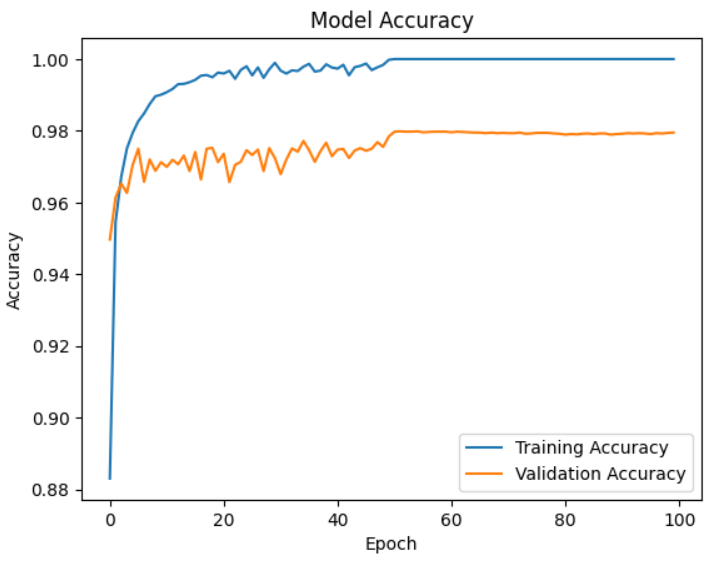
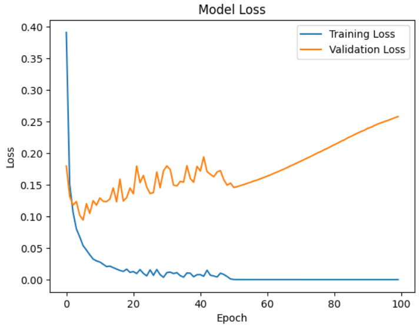

# DigitMind
### Handwritten Digit Recognition using Neural Networks

## About the Project

DigitMind is a beginner machine learning project where I built a neural network using TensorFlow and Keras to recognize handwritten digits from 0 to 9.

I used the MNIST dataset, which contains 70,000 grayscale images of handwritten digits. The goal was to train a model that can classify these images correctly.

## Dataset

- Dataset: MNIST
- Training images: 60,000
- Testing images: 10,000
- Image size: 28 × 28 pixels
- Classes: 10 (digits 0–9)

## Model Architecture

I built the model using TensorFlow's Sequential API.

The architecture consists of:

- Flatten layer to convert each image into a one-dimensional array.
- Dense layer with 64 neurons and ReLU activation.
- Dense layer with 128 neurons and ReLU activation.
- Dense layer with 256 neurons and ReLU activation.
- Output layer with 10 neurons and Softmax activation.

## Training

The model was trained using the following configuration:

- Optimizer: Adam
- Loss function: Sparse Categorical Crossentropy
- Epochs: 100
- Batch size: 128
- Validation split: 20%


## Results

I used Matplotlib to visualize the model's performance during training. The training and validation accuracy and loss graphs are included in the repository as image files.

### Accuracy


### Loss



## Technologies

- Python
- TensorFlow
- Keras
- Matplotlib

## How to Run

Clone the repository:

```bash
git clone YOUR_REPOSITORY_URL
```

Install the required libraries:

```bash
pip install -r requirements.txt
```

Run the project:

```bash
python DigitMind.py
```

## What I Learned

Through this project, I practiced building and training neural networks, working with the MNIST dataset, understanding activation functions, and monitoring model performance using loss and accuracy.

## Author

Athmane Fartas
